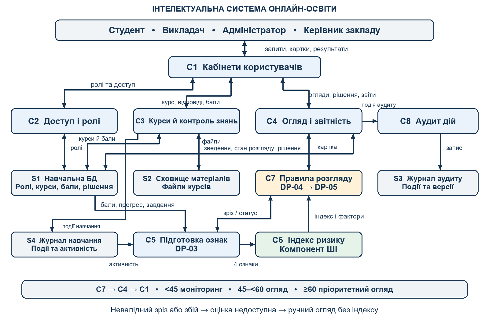

# Інтелектуальна система онлайн-освіти

## Problem

Викладачеві складно вчасно побачити, хто може не завершити дистанційний курс успішно, коли навчальні результати та активність розподілені між журналами. Система збирає ці дані в одному огляді й допомагає визначити порядок перевірки.

## Users

Студенти проходять курси й тести. Викладачі публікують матеріали, перевіряють результати та ухвалюють рішення про підтримку. Адміністратори керують ролями. Керівництво переглядає агреговані звіти.

## Solution

На 14-й день навчання система збирає бал тесту, прогрес курсу, стан контрольного завдання й час активності. Картка викладача показує індекс, внески ознак і статус розгляду. На основі картки і навчального контексту викладач може запропонувати підтримку, запросити уточнення або закрити випадок з причиною.

## Architecture



Кабінети C1 спираються на доступ і ролі C2, курси C3 та огляди C4. Сховища S1 і S4 живлять підготовку ознак C5. Компонент ШІ C6 розраховує індекс. Правила C7 визначають маршрут, а C8 записує аудит у S3. S2 зберігає матеріали курсу. [Сценарії і точки рішень](docs/use_cases_and_decisions.md).

## AI component

`rules-1.0` — пояснювана система правил. Індекс від 0 до 100 складається зі зважених внесків бала тесту, прогресу, контрольного завдання та часу. Він є індексом для сортування карток. На етапі DP-03 відсутні або невалідні ознаки зупиняють розрахунок. У DP-04 <45 означає моніторинг, 45–<60 — звичайний огляд, ≥60 — пріоритетний огляд. Некоректні дані або збій дають статус «оцінка недоступна» і ручну перевірку без індексу. У DP-05 викладач вирішує, чи звертатися до студента.

## Prototype

Відкрийте [risk_prototype.ipynb](prototype/risk_prototype.ipynb) у Jupyter або Google Colab і запустіть усі клітинки. Блокнот містить код, тестові дані та фактичні результати. Для повторення обох наборів зі стандартною бібліотекою Python 3 виконайте з кореня репозиторію:

```sh
python prototype/run_checks.py smoke
python prototype/run_checks.py extended
```

Реалізація та вхідні набори містяться в `prototype/`. Команди повторно створюють CSV та локальні HTML-результати поряд зі скриптом. Зразок S02 з ознаками (45, 48, false, 60) дає індекс 62,20 і пріоритетний огляд.

## Results

- ПР-6 — [8/8 збігів маршруту](results/smoke_results.csv), зокрема на межах 45 і 60. [Скріншот запуску](results/smoke.png).
- ПР-7 — [18 нових синтетичних прикладів](results/evaluation_results.csv). На 16 валідних записах отримано 6 TP, 5 TN, 2 FP і 3 FN. Точність 68,75 %, точність позитивного сигналу 75,00 %, повнота 66,67 %. Дві відмови з двох коректні. [Метрики](results/evaluation_metrics.json) · [Скріншот](results/evaluation.png).

## Limitations

Дані синтетичні, тому відсотки характеризують лише ці приклади. Один зріз пропускає пізні зміни активності. Прототип реалізує C6 та маршрутизацію C7. Інші модулі представлені проєктом архітектури.

## Future development

Перевірити правила на незалежних знеособлених історіях з різних курсів, додати повторні зрізи та ознаки динаміки. Перед пілотним запуском перевірити повноту, навантаження на викладачів і роботу ручного резервного маршруту.
